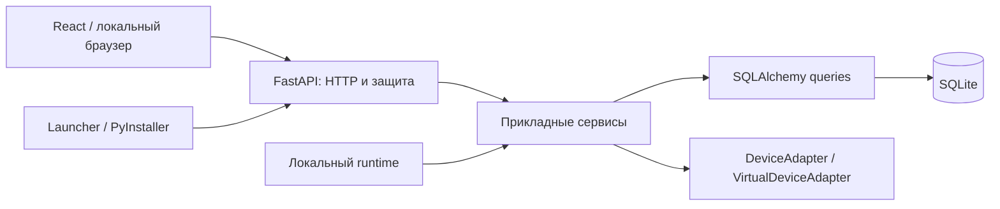

# Архитектура

Основной документ — ТЗ v1.0. Поздняя инструкция пользователя разрешает переходить
к следующему этапу автоматически после успешных проверок.

React отображает данные и отправляет команды. Логика устройств, правил и
расписаний выполняется backend. Адаптер получает снимок сохранённого состояния и
возвращает результат; отдельного словаря состояний в памяти нет.

Синхронные ORM-сессии выделяются на запрос/операцию. `BEGIN IMMEDIATE` предшествует
чтению изменяемого состояния. Состояние и событие сохраняются одной транзакцией.
Рекурсивные правила обрабатываются после commit, с путём запуска, глубиной,
общим бюджетом и cooldown. Ошибка правила не превращает уже сохранённую команду
в ложный HTTP-сбой; ошибка регистрируется.

Lifespan применяет Alembic, подключает адаптер, восстанавливает планирование и
запускает runtime. При завершении ожидается окончание фоновой операции, затем
освобождаются подключения и OS file lock. Второй симулятор одной БД не запускается.
Общий gate запросов и runtime обеспечивает безопасное восстановление из backup;
асинхронное ожидание gate не занимает пул синхронных обработчиков.

Сессии авторизации сохраняются в SQLite как хеши случайных токенов. Пароль —
PBKDF2-SHA256, уникальная соль, 600 000 итераций. API защищён cookie, CSRF и Origin;
CORS для внешних сайтов не включён. Все сетевые слушатели только loopback.

Launcher не создаёт отдельный Python-процесс: Uvicorn работает в том же процессе.
Выбранный socket передаётся серверу без гонки освобождения порта. Метаданные
экземпляра содержат PID, порт и случайный идентификатор; проверка health исключает
ошибочное открытие другого сервера на переиспользованном порту. PyInstaller
включает frontend, миграции, tzdata и Python-компоненты. Данные — в профиле Windows.
