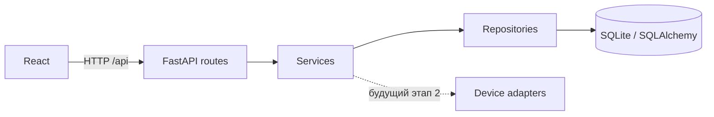

# Архитектура этапа 1

Основной документ требований — [ТЗ v1.0](tz-v1.0.md). Он имеет приоритет над
предыдущими предложениями: браузер и PyInstaller вместо Electron, Windows-сборка
на этапе 7, префикс API `/api`, путь БД `SmartHome/data/smart_home.db`.

## Границы слоёв

- `frontend`: отображение данных, загрузка и ошибки, HTTP-клиент. Прямого
  доступа к SQLite и логики устройств нет.
- `api`: HTTP-коды, зависимости сессии и вызов сервиса. Единственный прикладной
  endpoint этапа 1 — `/api/health`.
- `services`: проверка доступности и версии схемы, без зависимости от HTTP.
- `repositories`: запрос к БД для проверки состояния. Репозитории сущностей
  добавятся вместе с операциями этапа 2, без пустых CRUD-заглушек.
- `database`: engine, сессии, транзакции, миграции.
- `models`: описание сохраняемых сущностей и ограничений.
- `schemas`: Pydantic-ответы и валидация структуры JSON перед записью.
- `adapters`: типизированный `Protocol`. Это контракт расширения, а не
  реализация симулятора. Конкретный `VirtualDeviceAdapter` — этап 2.
- `launcher`: пока только описание будущей реализации этапа 7.

## SQLite и жизненный цикл

Синхронный SQLAlchemy выбран для простого локального приложения без
дополнительного асинхронного драйвера. Обычные синхронные маршруты FastAPI
выполняются в пуле потоков. Каждому запросу выделяется собственная Session;
глобальной общей сессии нет. Сервисы записи на будущих этапах должны использовать
явный `with session.begin()` для атомарных изменений и журналирования.

Создание приложения и импорт модулей не создают БД. Во время lifespan каталог
данных создаётся, Alembic применяет `upgrade head`, затем API становится готовым.
При ошибке старта либо штатном завершении engine освобождается. Повторный запуск
не удаляет записи и не создаёт демоданные. `foreign_keys=ON` устанавливается на
каждом подключении; ожидание блокировки SQLite ограничено 10 секундами.

Миграции содержат зафиксированные SQLAlchemy-типы, не зависят от изменяемых
классов валидации приложения и сверяются с ORM-метаданными тестом.
Даты в Python имеют UTC timezone; в SQLite хранятся в UTC без суффикса зоны.

## Будущая сборка

По ТЗ: собранный React обслуживается FastAPI, один локальный backend запускается
Python-launcher и упаковывается PyInstaller. Launcher проверит готовность,
откроет стандартный браузер и обеспечит один экземпляр. Завершение сервера будет
явным действием в интерфейсе. Эти возможности ещё не реализованы.

Первый этап требует двух dev-процессов. Docker, Electron, MQTT, Home Assistant,
облачные API, WebSocket, внешние шрифты и CDN не подключаются. GitHub используется
для исходников и CI разработки; для работы будущего приложения он не потребуется.
