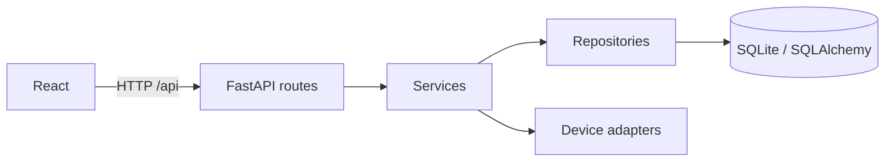

# Архитектура этапов 1–2

Основной документ требований — [ТЗ v1.0](tz-v1.0.md). Он имеет приоритет над
предыдущими предложениями: браузер и PyInstaller вместо Electron, Windows-сборка
на этапе 7, префикс API `/api`, путь БД `SmartHome/data/smart_home.db`.

## Границы слоёв

- `frontend`: отображение данных, загрузка и ошибки, HTTP-клиент. Прямого
  доступа к SQLite и логики устройств нет.
- `api`: HTTP-коды, зависимости сессии и вызов сервиса. Единственный прикладной
  endpoint проверки состояния — `/api/health`. CRUD и команды вызывают сервисы.
- `services`: CRUD, транзакции, команды, журналирование и setup, без зависимости от HTTP.
- `repositories`: запросы комнат и устройств, фильтры, подсчёты и проверка связей.
- `database`: engine, сессии, транзакции, миграции.
- `models`: описание сохраняемых сущностей и ограничений.
- `schemas`: Pydantic-ответы и валидация структуры JSON перед записью.
- `adapters`: типизированный `Protocol`, реестр и `VirtualDeviceAdapter` для
  шести типов устройств. Сервис передаёт снимок сохранённого состояния;
  адаптер возвращает новое состояние без собственного хранилища и SQL-запросов.
- `launcher`: пока только описание будущей реализации этапа 7.

## SQLite и жизненный цикл

Синхронный SQLAlchemy выбран для простого локального приложения без
дополнительного асинхронного драйвера. Обычные синхронные маршруты FastAPI
выполняются в пуле потоков. Каждому запросу выделяется собственная Session;
глобальной общей сессии нет. Сервисы записи на будущих этапах должны использовать
`write_transaction`: `BEGIN IMMEDIATE` до чтения текущего состояния, затем
проверки, изменение и событие с общим commit. Это предотвращает потерю изменений
при конкурирующих командах. Ошибка записи откатывает всю операцию.

Создание приложения и импорт модулей не создают БД. Во время lifespan каталог
данных создаётся, Alembic применяет `upgrade head`, затем API становится готовым.
При ошибке старта либо штатном завершении engine освобождается. Повторный запуск
не удаляет записи и не создаёт демоданные. Виртуальный адаптер подключается в
lifespan и отключается при завершении. `foreign_keys=ON` устанавливается на
каждом подключении; ожидание блокировки SQLite ограничено 10 секундами.

Миграции содержат зафиксированные SQLAlchemy-типы, не зависят от изменяемых
классов валидации приложения и сверяются с ORM-метаданными тестом.
Даты в Python имеют UTC timezone; в SQLite хранятся в UTC без суффикса зоны.

Схема этапа 2 не менялась: используется миграция `0001`, существующая база этапа 1
сохраняется. Новый функционал построен на исходных моделях.

## Первоначальная настройка и журнал

`python -m app.database.setup` — отдельный контролируемый механизм: пароль
вводится без отображения, хранится PBKDF2-SHA256 с солью, пользователь и дом
создаются с четырьмя начальными комнатами. Повторный запуск проверяет пароль и
возвращает существующий дом. Демоустройств нет. Полноценная авторизация API
по-прежнему относится к этапу 6.

Журналирование разделяет `user`, `manual_simulation`, `configuration` и
`initialization`. Виртуальный адаптер обрабатывает команды детерминированно.
В нём пока нет фоновых задач; симуляция по времени и планировщик — этап 5.

## Будущая сборка

По ТЗ: собранный React обслуживается FastAPI, один локальный backend запускается
Python-launcher и упаковывается PyInstaller. Launcher проверит готовность,
откроет стандартный браузер и обеспечит один экземпляр. Завершение сервера будет
явным действием в интерфейсе. Эти возможности ещё не реализованы.

Первый этап требует двух dev-процессов. Docker, Electron, MQTT, Home Assistant,
облачные API, WebSocket, внешние шрифты и CDN не подключаются. GitHub используется
для исходников и CI разработки; для работы будущего приложения он не потребуется.
